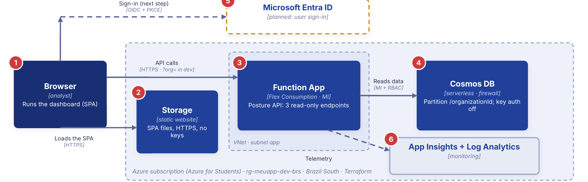

# Security Posture Dashboard

A read-only web dashboard that answers one question for an organization: **where do we stand on information security?** It shows one consolidated security score, five indicators and the controls behind each one, for the organization the user belongs to. Everything runs on Microsoft Azure and is provisioned with Terraform.

## 1. Overview

**Business problem.** Security evidence is scattered across scanners, spreadsheets, audits and tickets, so the person who reports to the board rebuilds the organization's posture by hand every week, and the sources disagree. This dashboard gives that person one score and five indicators for their own organization, with a drill-down into the overdue controls that explain a falling indicator.

**Group.** Gustavo Zilles, Vinicius Mello, Renan Metzen, Rodrigo Cassel. Trending Information Technologies, Unisinos, 2026/2.

**Grau B presentation.** [docs/slides/grau-b-implementation.pdf](docs/slides/grau-b-implementation.pdf)

## 2. Architecture



| Service | Role |
|---|---|
| **Azure Storage (static website)** | Serves the dashboard's HTML, CSS and JavaScript over HTTPS. Shared-key access is disabled. |
| **Azure Functions (Flex Consumption)** | The Posture API, in Python: three read-only endpoints. Runs inside the VNet and reaches the database with its managed identity. |
| **Azure Cosmos DB (serverless)** | Stores the posture data, one partition per organization (`/organizationId`). Key authentication is off and the firewall admits only the API's subnet. |
| **Application Insights + Log Analytics** | Requests, errors, an `AUTHZ` event per access decision, and the security logs of every other service, with saved queries for review. |
| **Microsoft Entra ID** | Planned user sign-in (OIDC + PKCE). Not active yet: the university tenant blocks app registrations (see [Known limitations](#6-known-limitations)). |

All resources live in `rg-meuapp-dev-brs` (Brazil South) in an Azure for Students subscription.

## 3. Repository layout

```
.
├── apps/
│   ├── web/          Dashboard: vanilla HTML/CSS/JS, no build step; mock-data.js holds the sample data
│   └── api/          Posture API: Azure Functions in Python, with unit tests in tests/
├── scripts/seed/     Loads the sample data from apps/web/mock-data.js into Cosmos DB
├── modules/          Terraform modules: networking, storage, static_site, cosmosdb, function_app, monitoring, security_monitoring
├── envs/
│   ├── dev/          Terraform root of the deployed environment
│   ├── stg/ prd/     Terraform roots of the other environments (planned, not deployed)
│   └── shared/       Subscription-level settings: Activity Log export, Defender security contact
├── bootstrap/        One-time script: remote Terraform state, resource groups, resource providers
├── docs/             Slides, architecture diagram, security monitoring and evidence, infrastructure guide
└── .github/          CI workflows (disabled until Entra ID app registrations are available)
```

## 4. How to evaluate

Three paths, from quickest to most complete. **Paths 1 and 2 are the recommended ones**: path 3 needs access to the Azure subscription.

### Path 1: live on Azure

- Dashboard: **https://stwebmeuappdevtmfdtk.z15.web.core.windows.net/**
  Switch between Organization A and Organization B in the yellow bar. Click an indicator to see its controls.
- API base URL: **https://func-meuapp-dev-brs.azurewebsites.net/api**

```bash
curl https://func-meuapp-dev-brs.azurewebsites.net/api/health
```

```bash
curl "https://func-meuapp-dev-brs.azurewebsites.net/api/posture?org=org-a"
```

```bash
curl "https://func-meuapp-dev-brs.azurewebsites.net/api/indicators/vuln-mgmt/controls?org=org-a"
```

An invalid organization returns `400` and a missing one returns `404`:

```bash
curl "https://func-meuapp-dev-brs.azurewebsites.net/api/posture?org=../../x"
```

### Path 2: without Azure

Serves the dashboard on your machine with the sample data. Needs only Python 3.

```bash
cd apps/web
python3 -m http.server 8080
```

On Windows, use `python` instead of `python3`. Then open **http://localhost:8080/?mock=1**.

`?mock=1` is required: without it the page calls the live API, which only accepts requests from the dashboard's own address (CORS), so it fails from `localhost`.

### Path 3: full stack

**Prerequisites:** Git, Python 3.13, Terraform 1.9+, Azure CLI, Azure Functions Core Tools v4.

#### 3a. API unit tests (no Azure needed)

From the repository root:

```bash
python3 -m venv .venv
source .venv/bin/activate
pip install -r apps/api/requirements.txt
python -m unittest discover -s apps/api/tests -v
```

On Windows (PowerShell), create the environment with `python -m venv .venv` and activate it with `.venv\Scripts\Activate.ps1`. If PowerShell refuses to run the script, allow it for the current window only with `Set-ExecutionPolicy -Scope Process -ExecutionPolicy Bypass` and activate again. The 25 tests run against an in-memory Cosmos DB: they check the API's responses against `apps/web/mock-data.js`, input validation, the `AUTHZ` event and that no token or header ever reaches the logs.

#### 3b. Infrastructure

The Terraform state lives in this project's Azure subscription, so these commands only work for a user with access to it.

```bash
az login
cd envs/dev
terraform init
terraform plan
```

The expected plan has one in-place change on the Function App (two app settings kept empty on purpose; see [docs/infrastructure.md](docs/infrastructure.md)). To deploy into **your own** subscription instead, run `bootstrap/bootstrap.sh` and update `envs/dev/backend.tf` and `envs/dev/terraform.tfvars`, as described in the same guide.

#### 3c. API locally

With the virtual environment from 3a still active:

```bash
cd apps/api
cp local.settings.sample.json local.settings.json
func start
```

On Windows (PowerShell), use `copy` instead of `cp`. In another terminal:

```bash
curl http://localhost:7071/api/health
```

The local API answers `/health` and rejects invalid input (`400`), but a valid `/posture` request returns `500`: the Cosmos DB firewall only admits the deployed Function's subnet, so your machine cannot read the data.

#### 3d. Seed data

The seed script writes the sample data from `apps/web/mock-data.js` into Cosmos DB, signing in with your `az login` (no keys). Because of the firewall, it needs your public IP allowed **temporarily**:

1. Add `cosmos_ip_range_filter = ["<your-ip>"]` to `envs/dev/terraform.tfvars`, then `terraform plan` and `terraform apply` in `envs/dev`.
2. Run the seed from the repository root (bash shown; in PowerShell set the variable with `$env:COSMOS_ENDPOINT = "..."`):

   ```bash
   export COSMOS_ENDPOINT=https://cosmos-meuapp-dev-brs.documents.azure.com:443/
   python scripts/seed/seed.py
   python scripts/seed/seed.py --check
   ```

3. Remove the IP from `terraform.tfvars`, then `terraform plan` and `terraform apply` again.

The upsert is idempotent: running it twice does not duplicate data.

## 5. Security

- **No secrets anywhere.** The API reaches Cosmos DB and Storage with its managed identity and data-plane roles only (Cosmos DB Data Reader). Key-based access is disabled on Cosmos DB and on every storage account, and no connection string with a key exists in code, configuration or history.
- **Isolation.** The API runs inside a VNet. Cosmos DB and the API's storage only admit the API's subnet, so the data is unreachable from the internet even with valid credentials. CORS admits only the dashboard's address.
- **Hardening.** HTTPS only, TLS 1.2 minimum, basic-auth publishing (FTP and WebDeploy) disabled on the Function App, deploys only with Entra ID.
- **Monitoring.** Logs from the API, the Function host, Cosmos DB, both storage accounts and the subscription's Activity Log go to one Log Analytics workspace, with 11 saved queries for review: denials, organization enumeration, blocked database access, writes to the website, key usage, control-plane changes and deploys. Alerts were designed but not created, to keep the fixed cost at zero.

Details, the NIST SP 800-53 mapping and the evidence of each scenario: [docs/security-monitoring.md](docs/security-monitoring.md).

## 6. Known limitations

- **`dev-anonymous` mode.** The university's Entra ID tenant does not let students register applications, so user sign-in is not active. In dev, the API takes the organization from the `?org=` query string, validated against `^org-[a-z0-9-]{1,40}$`, and anyone can read either organization by changing it. This is acceptable only because dev holds **fictitious data**. Every decision is still logged as an `AUTHZ` event.
- **Other environments answer 401.** `stg` and `prd` are defined in Terraform but not deployed. The API's default mode (`entra`) answers `401 {"error": "authentication not configured"}`, and only dev's `terraform.tfvars` turns on `dev-anonymous`.
- **No alerts and no sign-in logs.** Monitoring relies on reviewing the saved queries, and the tenant does not export Entra ID sign-in logs. See [docs/security-monitoring.md](docs/security-monitoring.md) for the full list.
- **CI disabled.** The GitHub Actions workflows need the same Entra ID app registrations, so deploys run locally with `az login`.
