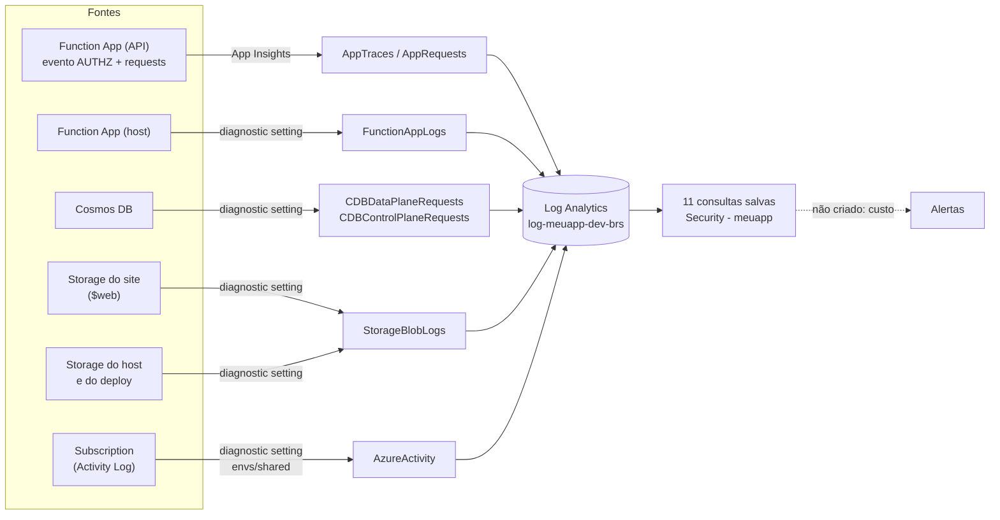

# Monitoramento de segurança: Security Posture Dashboard (dev)

Logs de segurança de cinco fontes chegam a um único workspace do Log Analytics, onde 11 consultas salvas fazem a revisão. Cada consulta foi provada com um cenário controlado (Fase 6). Tudo é Terraform, sem custo fixo: os alertas foram avaliados e não criados por decisão de custo.

- Workspace: `log-meuapp-dev-brs` (Brazil South), cota diária de 0,1 GB
- Consultas: Log Analytics → Consultas salvas → categoria **Security - meuapp**
- Evidências: [`docs/evidence/`](evidence/)

## 1. Fluxo



## 2. Fonte, tabela, detecção e consulta

| Fonte | Tabela | O que detecta | Consulta salva | Alerta |
|---|---|---|---|---|
| API (`apps/api/lib/audit.py`) | `AppTraces` (`AUTHZ ...`) | Negações por motivo, rota e IP | `authz-denials-by-reason` | não criado |
| | | Um IP testando mais de 3 organizações em 1 h | `authz-org-enumeration` | não criado |
| | | Entradas inválidas (`invalid_org`, `invalid_key`) | `authz-injection-attempts` | — |
| API | `AppRequests` | Taxa de erro 5xx e p95 por endpoint | `api-health-and-latency` | não criado (teste de disponibilidade) |
| Cosmos DB | `CDBDataPlaneRequests` | Requisições recusadas (403) por IP | `cosmos-denied-requests` | — |
| | | Leitura de dados por principal diferente da Function | `cosmos-unexpected-principal` | — |
| | `CDBControlPlaneRequests` | Mudanças de configuração da conta | (investigação) | — |
| Storage do site | `StorageBlobLogs` | Escrita ou exclusão no `$web` | `web-writes-outside-deploy` | — |
| As duas storages | `StorageBlobLogs` | Uso de chave compartilhada | `storage-sharedkey-attempts` | — |
| Storage do host | `StorageBlobLogs` | Pacote de deploy gravado | `function-deployments` | — |
| Subscription | `AzureActivity` | RBAC, `listKeys`, regras de rede, exclusão de diagnostic setting, credenciais de publicação | `control-plane-security-changes` | não criado |
| | | Mudanças de configuração e reinícios da Function | `function-deployments` | — |
| Function (host) | `FunctionAppLogs` | Inicializações, falhas de configuração e de acesso a storage | (investigação) | — |
| Log Analytics | `Usage`, `_LogOperation` | Volume por tabela e cota diária atingida | `log-ingestion-and-cap` | não criado |

"Não criado" marca os alertas propostos na Fase 5. O custo estimado era de US$ 4,88 a US$ 10,64 por mês, e eles foram adiados por decisão do responsável. As consultas existem e podem virar alertas sem mudança no código delas.

### O evento `AUTHZ`

Uma linha por decisão de autorização em `/posture` e `/indicators/{key}/controls`:

```
AUTHZ {"route":"/posture","authMode":"dev-anonymous","outcome":"denied","reason":"invalid_org","org":"??????x","status":400,"ip":"203.0.113.7"}
```

- `route` é o modelo da rota, nunca a URL real: um payload de injeção no caminho não vai para o log.
- `org` é truncado em 40 caracteres e reduzido a `[a-z0-9-]` (o resto vira `?`).
- `ip` vem do `X-Forwarded-For` e só é gravado se for um endereço válido.
- Token, cabeçalhos, cookies, query string e corpo nunca são registrados. Há um teste que chama a Function com esses valores marcados e confere que nenhum aparece em log algum.

## 3. Mapeamento NIST SP 800-53

| Controle | Como é atendido | Onde |
|---|---|---|
| **AU-2** Event logging | Os eventos registrados foram escolhidos por risco: decisões de autorização, acesso a dados, escrita no site, uso de chave e mudanças no plano de controle. Leituras da storage do host ficaram de fora de propósito (ruído e custo). | Seção 2; módulos com `log_analytics_workspace_id` |
| **AU-3** Content of audit records | O `AUTHZ` registra o quê (rota), resultado, motivo, sobre quem (organização sanitizada), de onde (IP) e quando (timestamp do App Insights), sem segredo. As tabelas da Azure trazem principal, IP e operação. | `apps/api/lib/audit.py`, `apps/api/tests/test_audit.py` |
| **AU-6** Audit review, analysis and reporting | 11 consultas salvas, versionadas no Terraform, executadas e guardadas como evidência. | `modules/security_monitoring/`, `docs/evidence/query-*.txt` |
| **AU-9** Protection of audit information | Diagnostic settings criados pelo Terraform: apagar um aparece como diferença no `terraform plan` e como `diagnosticsettings/delete` na consulta `control-plane-security-changes`. Sem alerta automático (não criado). | `envs/dev`, `envs/shared` |
| **AU-12** Audit record generation | Geração em cada camada: aplicação (`AUTHZ`), host (`FunctionAppLogs`), dados (Cosmos e storages) e plano de controle (`AzureActivity`). | Seção 1 |
| **SI-4** System monitoring | Monitoramento por consultas de revisão. A detecção automática (alertas) foi desenhada e orçada, mas não criada. É a principal lacuna. | Seção 2, Fase 5 |
| **CM-3** Configuration change control | Mudanças passam pelo Terraform, com plan revisado antes de cada apply. O `AzureActivity` registra quem mudou o quê, e a escrita do pacote mostra cada deploy. | `control-plane-security-changes`, `function-deployments` |
| **AC-3** Access enforcement | As negações provam a aplicação da regra: organização inválida (400), inexistente (404), indicador inexistente (404), firewall do Cosmos (403). | `docs/evidence/cenario-1`, `-3` |
| **AC-6** Least privilege | A Function só lê o Cosmos (Data Reader), o operador só escreve no site com o próprio login, sem chaves em lugar nenhum. A consulta `cosmos-unexpected-principal` vigia leituras fora da identidade esperada. | `envs/dev/main.tf` |

## 4. Limitações conhecidas

- **Sem logs do Entra ID** (`SigninLogs`, `AuditLogs`). O tenant é institucional, sem permissão de administrador nem licença para exportá-los. Logins e mudanças de identidade não são vistos.
- **Sem alertas.** Toda detecção depende de alguém rodar as consultas. Um ataque em andamento não avisa ninguém.
- **`AUTH_MODE=dev-anonymous`.** O `AUTHZ` registra a decisão, mas a organização ainda vem da query string, então quem a troca lê outra organização. Só dados fictícios, só em dev. stg e prd respondem 401.
- **Cota diária do Log Analytics.** Se os 0,1 GB estourarem, a ingestão para até o dia seguinte: um ponto cego. A consulta `log-ingestion-and-cap` mostra quando aconteceu, mas só depois.
- **Tentativa com chave compartilhada inválida não é registrada.** Uma chave errada falha na autenticação antes de gerar linha em `StorageBlobLogs`. A consulta 7 só vê uso de chave que foi aceito (hoje impossível, porque as contas recusam chave) ou recusado por política.
- **Bloqueios do firewall do Cosmos vêm sem principal.** O 403 de rede acontece antes da identificação, então a consulta `cosmos-unexpected-principal` não vê tentativas barradas. Elas aparecem por IP em `cosmos-denied-requests`.
- **O Activity Log pode perder eventos.** Na noite de 04/10/2026, os eventos administrativos entre ~01:05 e ~02:00 UTC nunca chegaram ao workspace, embora estivessem na origem. A exportação seguiu funcionando depois.
- **Ruído do próprio Terraform.** Todo `plan` lê chaves (`listKeys`, `listConnectionStrings`, `ListPublishingCredentials`) para atualizar o state, e isso aparece em `control-plane-security-changes`. O critério para separar é o `Caller` e o horário batendo com um plan.
- **Retenção.** As tabelas ficam 30 dias (`AzureActivity`, 90). Evidência precisa ser salva em arquivo dentro da janela.
- **Sem flow logs de rede e sem SIEM**, por custo. Num ambiente real, este workspace alimentaria o Microsoft Sentinel.
- **Postura.** Planos pagos do Defender, private link e proteção DDoS foram aceitos como risco ou deixados fora de escopo. Ver [`evidence/defender-posture.txt`](evidence/defender-posture.txt).

## 5. Evidências

| Cenário | Saída | Consulta |
|---|---|---|
| 1. Negações na API | [cenario-1-negacoes-api.txt](evidence/cenario-1-negacoes-api.txt) | [authz-denials-by-reason](evidence/query-authz-denials-by-reason.txt), [authz-injection-attempts](evidence/query-authz-injection-attempts.txt) |
| 2. Enumeração de organizações | [cenario-2-enumeracao.txt](evidence/cenario-2-enumeracao.txt) | [authz-org-enumeration](evidence/query-authz-org-enumeration.txt) |
| 3. Leitura direta do Cosmos barrada | [cenario-3-cosmos-barrado.txt](evidence/cenario-3-cosmos-barrado.txt) | [cosmos-denied-requests](evidence/query-cosmos-denied-requests.txt) |
| 4. Chave compartilhada inválida | [cenario-4-chave-compartilhada.txt](evidence/cenario-4-chave-compartilhada.txt) | [storage-sharedkey-attempts](evidence/query-storage-sharedkey-attempts.txt) (vazia: ver limitações) |
| 5. Escrita no `$web` | [cenario-5-escrita-web.txt](evidence/cenario-5-escrita-web.txt) | [web-writes-outside-deploy](evidence/query-web-writes-outside-deploy.txt) |
| 6. `listKeys` no Cosmos | [cenario-6-listkeys.txt](evidence/cenario-6-listkeys.txt) | [control-plane-security-changes](evidence/query-control-plane-security-changes.txt) |
| 7. Redeploy da API | [cenario-7-redeploy.txt](evidence/cenario-7-redeploy.txt) | [function-deployments](evidence/query-function-deployments.txt) |
| Postura (Defender) | [defender-posture.txt](evidence/defender-posture.txt) | — |

As outras consultas ([cosmos-unexpected-principal](evidence/query-cosmos-unexpected-principal.txt), [api-health-and-latency](evidence/query-api-health-and-latency.txt), [log-ingestion-and-cap](evidence/query-log-ingestion-and-cap.txt)) não dependem de cenário e foram executadas junto. Os IPs têm o último octeto mascarado.

## Depois do Entra ID

- Trocar a origem do `reason` para as claims do token: `missing_token`, `invalid_token`, `wrong_audience`, `org_not_in_roles`. A organização passa a vir da role e o `org` do evento deixa de ser entrada do usuário.
- Ligar a exportação de `SigninLogs` e `AuditLogs` para o mesmo workspace, se o tenant permitir.
- Reavaliar os alertas da Fase 5, começando pelos de log (US$ 0,50 por mês cada).
